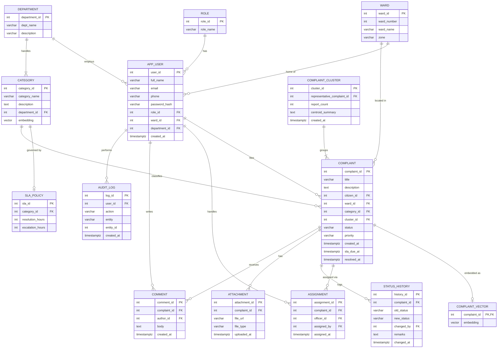

# CivicResolve

## DBMS Experiential Learning - Level 3 Project

**CivicResolve - A Grievance Deduplication and Smart Routing System for Urban Local
Bodies (ULBs).**

Municipal grievance portals receive duplicate reports about the same pothole, broken
streetlight, or water leak, while complaints can also be routed to the wrong
department. CivicResolve uses semantic similarity search to merge duplicate
complaints into a tracked cluster, route each complaint to the most relevant
category and department, and escalate tickets that breach their SLA.

| Team member | SRN |
|---|---|
| Aadish Sarin | PES2UG24CS007 |
| Aditya Alur | PES2UG24CS052 |

Both members contribute to the database and application.

## What it does

- **Merges duplicates:** a new complaint is compared by meaning with open complaints
  in the same ward. Matching reports join the existing cluster and increase its
  "reported by N citizens" count.
- **Routes automatically:** the complaint is assigned to the category whose
  description is semantically closest. The citizen does not choose a department.
- **Enforces deadlines:** each category has an SLA, and overdue complaints can be
  escalated through a stored procedure.
- **Maintains accountability:** assignments, status changes, comments, and important
  actions are recorded for officers and administrators.

This goes beyond CRUD through clustering, semantic routing, transactional ticket
merging, and SLA enforcement.

## Database design

**Chosen option: SQL + Vector Database.**

| Paradigm | Technology | Purpose |
|---|---|---|
| Relational | PostgreSQL | Users, roles, wards, departments, categories, complaints, assignments, status history, SLA policies, and audit logs |
| Vector | PostgreSQL with `pgvector` | 384-dimensional embeddings for complaint deduplication and category routing |

The relational model provides primary and foreign keys, constraints, transactions,
and auditability for structured civic data. The vector layer handles the one part
that exact-match SQL cannot: finding semantically similar natural-language
complaints. Keeping both in PostgreSQL lets the application update structured and
vector data in one transaction.

### Implemented schema

The database includes:

- roles, users, wards, departments, categories, and SLA policies;
- complaints and duplicate complaint clusters;
- assignments, status history, comments, attachments, and audit logs;
- category and complaint embeddings using `vector(384)`;
- B-tree indexes for common filters and an HNSW cosine-similarity index;
- the `v_department_open_load` view;
- functions and triggers for filing, routing, SLA deadlines, status history,
  priority changes, and audit logging;
- `sp_escalate_overdue()` for SLA-based escalation.



The executable SQL files are the source of truth for the implementation:

- [`db/01_schema.sql`](db/01_schema.sql) - tables, constraints, indexes, and view
- [`db/02_functions_triggers.sql`](db/02_functions_triggers.sql) - functions,
  triggers, and stored procedure
- [`db/03_seed.sql`](db/03_seed.sql) - master data and demo users
- [`db/04_report_queries.sql`](db/04_report_queries.sql) - report queries

## Technology stack

| Layer | Technology |
|---|---|
| Frontend | Next.js 15 App Router, React 19, JavaScript, plain CSS |
| Backend / API | Next.js Route Handlers under `app/api` |
| Relational database | PostgreSQL |
| Vector database | `pgvector` in PostgreSQL |
| Embeddings | `all-MiniLM-L6-v2` (384 dimensions), run locally with Transformers.js |
| Authentication | bcrypt password hashes, signed httpOnly session cookie, three roles |
| Local development database | PGlite with pgvector |

## Folder guide

```text
db/01_schema.sql              tables, constraints, indexes, view
db/02_functions_triggers.sql  functions, triggers, stored procedure
db/03_seed.sql                master data and demo users
db/04_report_queries.sql      reporting queries
scripts/local-db.mjs          local PostgreSQL-compatible database
scripts/setup-db.mjs          database setup and sample complaints
scripts/test-api.mjs          end-to-end API tests
lib/                          database, auth, embeddings, and shared helpers
app/api/                      backend routes
app/                          login, citizen, officer, and admin pages
components/                   forms, tables, and shared UI components
docs/                         report, diagrams, and screenshots
```

## Setup

You need Node.js 20.6 or newer. No separate database installation is required for
the local setup.

1. Install packages:

   ```bash
   npm install
   ```

2. Create `.env.local` from the example and set `SESSION_SECRET` to a random string
   of at least 32 characters:

   ```bash
   cp .env.example .env.local
   ```

3. Start the local database and leave it running in its own terminal:

   ```bash
   npm run db:local
   ```

4. In a second terminal, build the schema and load demo data. The first run downloads
   the embedding model (about 25 MB):

   ```bash
   npm run db:setup
   ```

5. Start the app and open <http://localhost:3000>:

   ```bash
   npm run dev
   ```

Demo accounts (one admin, four officers, and six citizens) and their passwords are
defined in [`db/03_seed.sql`](db/03_seed.sql).

### Using hosted PostgreSQL

To use a PostgreSQL server such as Neon or Supabase, set `DATABASE_URL`, remove
`DATABASE_POOL_MAX`, skip the local database step, and run `npm run db:setup`.
The `vector` and `pgcrypto` extensions must be available.

## Tests

With the database and app running:

```bash
npm test
```

This runs 32 end-to-end cases covering login, roles, deduplication, routing,
constraints, triggers, transactions, the stored procedure, and semantic search.
The tests change data, so run `npm run db:setup` again afterwards.

## DBMS concept coverage

| Concept | Demonstrated by |
|---|---|
| `CREATE`, `ALTER`, `DROP`, keys, and constraints | [`db/01_schema.sql`](db/01_schema.sql) |
| B-tree and HNSW indexes | [`db/01_schema.sql`](db/01_schema.sql) |
| View | `v_department_open_load` on the admin dashboard |
| Triggers | SLA deadline, resolved time, status history, priority bump, and audit log |
| Function | `fn_file_complaint()` for deduplication, routing, and insertion |
| Stored procedure | `sp_escalate_overdue()` |
| Transactions | `withTransaction()` in [`lib/db.js`](lib/db.js) |
| Vector similarity search | complaint filing, duplicate search, and admin semantic search |
| Joins, grouping, aggregates, and subqueries | dashboards and [`db/04_report_queries.sql`](db/04_report_queries.sql) |
| Database-level validation | `CHECK`, `UNIQUE`, and foreign-key constraints |
| Roles and authorization | Citizen, Officer, and Admin checks on pages and API routes |

## Documents

| File | Description |
|---|---|
| [`docs/CivicResolve_DBMS_Project_Report.docx`](docs/CivicResolve_DBMS_Project_Report.docx) and `.pdf` | Project report |
| [`docs/CivicResolve_DBMS_Level3_Submission.md`](docs/CivicResolve_DBMS_Level3_Submission.md) | Detailed DBMS submission |
| [`docs/diagrams/`](docs/diagrams/) | ER diagram, relational schema, and system architecture |
| [`docs/screenshots/`](docs/screenshots/) | Screenshots of the running application |

## Security notes

- Passwords are stored only as bcrypt hashes.
- Database credentials and the session secret live in `.env.local`, which is
  git-ignored.
- Queries use parameters; table and column names never come from requests.
- The session cookie is httpOnly and signed, and role checks happen on the server.

## Known limits

- Photos are attached as a link rather than uploaded.
- Escalation runs when an admin presses the button. A production system would
  schedule it, for example with `pg_cron`.
